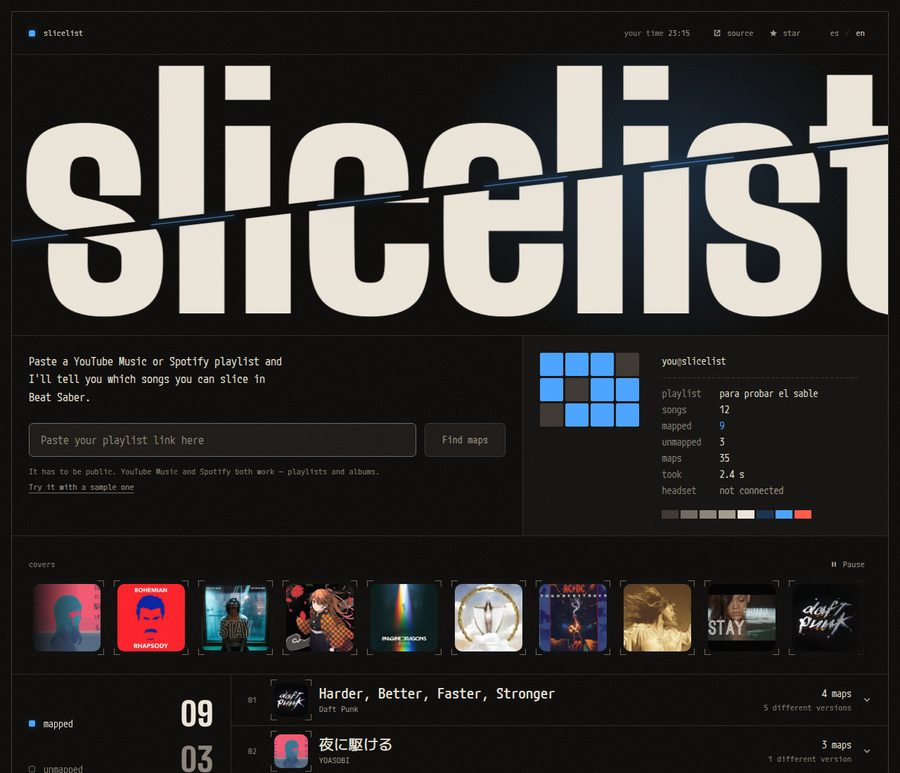

# slicelist

Paste a YouTube Music or Spotify playlist. Find Beat Saber maps on [BeatSaver](https://beatsaver.com), preview them, download, or send them to a Quest over USB.

https://github.com/Zergiv/slicelist

[](#)
[](https://nextjs.org)
[](https://www.typescriptlang.org)
[](LICENSE)



## Usage

1. Paste a **public** playlist or album link (YouTube Music or Spotify).
2. Browse matches, preview audio, download maps.
3. In Chrome or Edge, connect a Quest over USB to send maps into Beat Saber (modded, e.g. [ModsBeforeFriday](https://github.com/Lauriethefish/ModsBeforeFriday)).

No API keys. Spotify playlists are capped at 200 tracks by default (`READER_MAX_TRACKS`).

## Install

Needs Node 24+, pnpm, and Python 3.10+.

```bash
pnpm install

python3 -m venv reader/.venv
reader/.venv/bin/pip install -r reader/requirements.txt
reader/.venv/bin/python reader/server.py   # 127.0.0.1:4191

pnpm dev -p 4200
```

Open `http://localhost:4200`. Sample playlist works without the reader.

### Production (PM2)

```bash
cp .env.example .env   # optional BeatSaver contact
pnpm install
python3 -m venv reader/.venv && reader/.venv/bin/pip install -r reader/requirements.txt
pnpm build
pm2 start ecosystem.config.cjs
```

Web on `:4200`. Reader stays on `127.0.0.1:4191` (not public). Quest send needs HTTPS or `localhost`.

```bash
pnpm test
pnpm typecheck
```

## Credits

| Piece | From |
| --- | --- |
| Maps | [BeatSaver](https://beatsaver.com) |
| YouTube Music playlists | [ytmusicapi](https://github.com/sigma67/ytmusicapi) |
| Quest ADB | [@yume-chan/adb](https://github.com/yume-chan/ya-webadb) |
| Zip in the browser | [fflate](https://github.com/101arrowz/fflate) |
| UI | [Next.js](https://nextjs.org), [React](https://react.dev), [Motion](https://motion.dev), [Tailwind](https://tailwindcss.com) |

Quest send path inspired by [ModsBeforeFriday](https://github.com/Lauriethefish/ModsBeforeFriday) (AGPL). This repo does not include their code.
